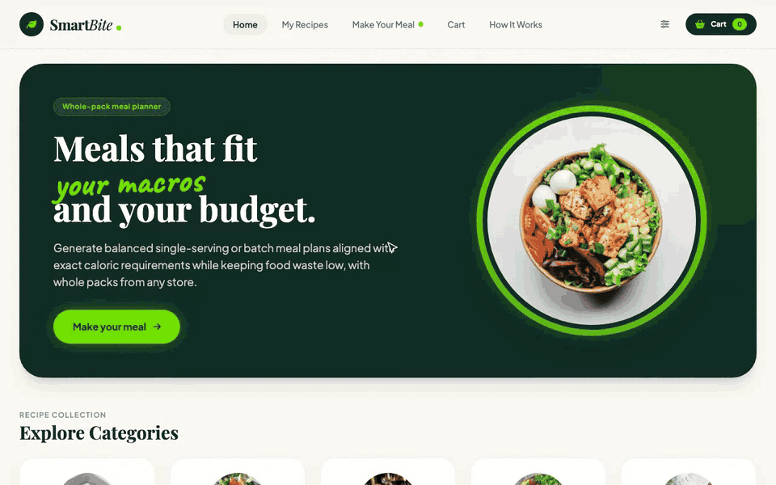
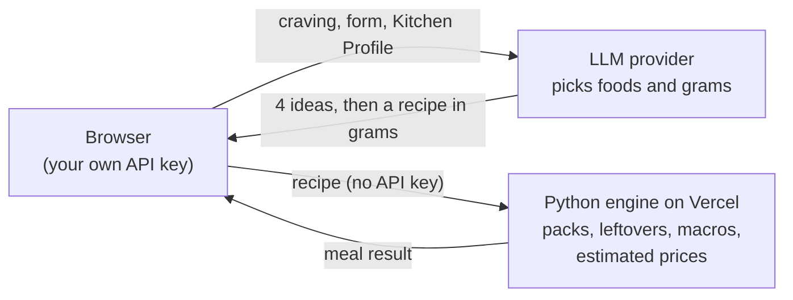

# SmartBite

**Whole-pack meal planner.**

SmartBite turns one craving, or a recipe you paste, into a recipe in grams, a shopping list in whole packs, macros per serving and a plan for the leftovers. A language model picks the foods and the grams. Every number after that comes from code: pack sizes, leftovers, macros and estimated prices are plain Python with tests, built on open nutrition, pack and price data.

Live site: https://smartbite-steel.vercel.app. The demo needs no setup, and 3 free meals need no API key.



## What you can do

- **Make a meal.** A short quiz takes your craving, targets, servings and budget, and the model writes 4 meal ideas. Pick one to get the recipe in grams, a shopping list in whole packs, and macros, fiber and micronutrients per serving.
- **Try it free.** With no API key you can make 3 meals on SmartBite's own key (Claude Haiku 5.5). Free-trial visitors also see the 13 demo meals as example recipes in My Recipes and on Home. Opening one does not use a free meal. After the 3 meals, you add your own key.
- **Paste a recipe.** Paste the text of a recipe you already cook and get the same packs, macros and prices for it.
- **Fit to packs.** On a meal you made, code changes the grams per serving and the number of servings so the meal uses the packs it buys. Apply saves the meal and the engine computes it again. Undo brings back the meal as it was before the first fit.
- **Shop.** The Cart puts several meals in one shopping list. "Adjust leftovers to meals" fits the leftovers into servings, and the list can be copied, printed or shared (where the browser can share).
- **Save your own products.** On a shopping line you can save the product you buy: pack size, price and label. A barcode fills these from Open Food Facts. The label wins for every value it has. Values a label leaves out, such as fiber and micronutrients, come from the general food table.
- **Plan a day.** My Day has Breakfast, Lunch, Snack and Dinner slots. Add saved recipes, or single foods from the Foods tab: it searches the general foods and your saved products with a label, takes grams (eggs in units and size) and shows macros, fiber, vitamins and minerals. The day adds up against daily targets you set on the Profile page. "Make a meal for what's left" starts a new meal from the calories and protein you still need.
- **Share a recipe.** A link carries the recipe, and whoever opens it gets packs, macros and estimated prices for their own country with no key and no setup.
- **Use it in English or Spanish.** The site follows your browser language. A switch in the footer and a Language setting on the Profile page change it. With the country set to Mexico, food names use Mexican Spanish ("ejotes", "frijoles"). Money and decimals follow the country: "5,50 €" in Spain, "$5.50" in the United States.
- **Use it on a phone.** On a phone the recipe page has three tabs: Recipe, Shopping and Nutrients.
- **Keep your data.** There are no accounts. Your meals, products and settings stay in your browser, and a profile file moves them to another browser. Your API key goes in that file only if you tick the box.

## The problem

Most meal planning apps write a plan first and send a list of generic food names to the store. The store then picks the products. Instacart's own API guide, for example, asks apps to send a generic product name with no weight, quantity or brand ([Instacart docs](https://docs.instacart.com/developer_platform_api/guide/how_to/specify_preferred_brands)). Once the product is chosen after the plan, the app cannot know the pack size you pay for or what is left over.

In real life you buy whole packs, and the grams in a recipe decide how many. Take canned tuna in 130 g cans for 7 servings: 93 g per serving is 651 g and buys a 6th can, while 92 g per serving fits in 5 cans. Among the meal apps reviewed for this project in October 2026, none was found that plans around packs like this (for two of them, Eat This Much and Prospre, no source covered it).

SmartBite does it the other way round:

- It plans with typical pack sizes, so the shopping list counts whole packs and the leftover grams are known before you shop.
- It fits leftovers into servings. It can change grams a little or add servings so the packs you buy get used.
- It computes macros in code from open food tables. The model gives only a rough guess on each idea card, and the recipe's macros never come from the model.

## How it works



**The LLM picks foods and grams. All math is code.**

- You bring your own API key. The browser calls the model provider directly, and the key never reaches the SmartBite server. The one exception is the free trial: with no key, the browser sends the form to `/api/trial` and the server calls Claude Haiku 5.5 with SmartBite's own key (see [Privacy and AI](#privacy-and-ai)).
- The model writes 4 meal ideas, then the full recipe for the one you pick. The recipe prompt tells it to write foods and grams per serving only, and never kcal or protein.
- The engine (`smartbite_engine`, served by FastAPI at `/api/evaluate`) maps each food to open nutrition values and typical pack sizes. It rounds up to whole packs and returns leftovers, macros per serving and an estimated price per pack where public price data exist: Spain (national, or for the user's comunidad autónoma), Canada, France, Ireland, the United Kingdom and the United States. Mexico and Australia get pack sizes and macros with no price for now.
- **Food names.** The prompts list 139 foods, the ones with pack sizes, and the model uses those names when it can. The engine knows 172 more for nutrition, 311 in all, so names in a pasted recipe, an edited meal or the My Day food search still count in the macros. Each food has an English and a Spanish name, plus the Mexican word where it differs ("betabel" for beetroot). A name that matches no food can still count through a word rule: "pork chops" counts as pork loin, and the meal says which food it was "counted as". Plain frozen salmon and frozen chicken use the raw records, as stated exceptions, because the tables have no plain frozen record. Breaded, sauced or cooked products never match them.
- When the macros miss their range (kcal within 10% of target, protein 90% to 120% of target) or a fresh food leaves more than 25% of what was bought unused, the browser sends the engine's numbers back to the model for a corrected recipe. That is at most 2 reruns. The rerun prompt gives the model a limit for each bought food of 15% over the first recipe; the reply is not checked against it in code.
- **Paste a recipe.** On My Recipes, the user's own key reads a pasted recipe (text, not a link: SmartBite never opens websites) into foods and grams for the whole recipe (`prompts/import.md`). Code then weighs counted pieces ("4 large potatoes") with USDA portion weights (`smartbite_engine/pieces.py`, `web/lib/pieces.js`), divides by the servings the text states, or asks once when it states none, and sends the recipe to the same engine. The recipe is kept as written, and the meal opens in the editor so the user checks foods and grams before saving it. A food SmartBite does not know, and no word rule matches, is kept and left out of the macros with a note. Once you save a product with a label for it, its label counts.
- **Share recipe.** A recipe page makes a link that holds the recipe after the `#` (compressed JSON): name, servings, prep time, foods, grams, steps and notes, the photo prompt, its rough macros and the kcal, protein, carbs and fat targets it was made for. Nothing else about the person who shared it goes in: no country, prices, products or profile. Browsers do not send the part after `#` to a server. Whoever opens it gets macros, packs and prices from the engine for the country set in their own browser (Spain until they pick one), with no key and no setup.
- "Adjust leftovers to meals" runs in the browser, also as code with no model. It first tries 1 to 8 servings of the main protein with grams that fill whole packs (cutting more than 15% only while protein stays at or above the target), then moves grams by up to 15% while protein stays at or above 90% of the target, then tries 1 to 8 servings for what is left. **Fit to packs** runs the same code on one meal, from its recipe page or from its My Recipes card when code finds a suggestion. It changes the saved meal and keeps a copy of the meal from before the first fit for Undo.
- **Labels and the food table.** A saved product's label wins for every value it has. A saved label holds kcal, protein, carbs and fat, and fiber and salt when given. Fiber when it is missing, and the micronutrients, come from the food's record in the general table. A value no source has stays unknown, not 0.

## Results

All numbers below are copied from the result files in `eval/results/` and `eval/recipe_import/results/`.

### Macros: open tables vs label-based values

The 13 demo meals were computed twice: once by this engine with generic open tables (Ciqual 2025, USDA FoodData Central), and once by the author's personal app, which uses the labels of the products actually bought plus a national food table. The personal values are a reference, not ground truth. Error = (open - reference) / reference, per serving. Built on 2026-10-19 by `eval/macro_compare.py` and re-run on 2026-10-20 after fixes to the pack and nutrition data ([full table](eval/results/macro-compare.md)).

| Meals | kcal mean abs error | kcal max error | kcal within 10% | protein mean abs error | protein max error | protein within 10% |
|---|---|---|---|---|---|---|
| 13 | 5.8% | 22.2% | 12 of 13 | 5.3% | 12.6% | 12 of 13 |

The one meal outside 10% on both is the tuna and chickpea salad with skyr dressing (kcal +22.2%, protein +12.6%).

### Recipe quality eval

15 golden cravings, 11 code checks each (165 checks): valid JSON, 4 ideas, idea names of 60 characters or less, the right number of servings, the recipe keeps the idea's main foods, no excluded food, rice and pasta in dry grams, eggs in units, grams for every ingredient, and macros inside the target range. The checks are code only. Replies for baseline and v2 were written on 2026-10-19. All three runs were re-scored on 2026-10-20 with the same checks, after the nutrition fix ([baseline](eval/results/baseline.md), [v2](eval/results/v2.md), [v3](eval/results/v3.md)).

| Run | Checks passed | macros_vs_target |
|---|---|---|
| baseline | 153/165 (92.7%) | 3/15 |
| v2 | 164/165 (99.4%) | 14/15 |
| v3 | 165/165 (100.0%) | 15/15 |

The baseline first scored 152/165. One baseline recipe added a short top-level "note" that the recipe contract did not allow at the time. The contract now allows an optional note of up to 200 characters, so the same reply passes and all three runs are scored against the same contract.

What changed from baseline to v2 (from the project notes; the baseline prompt was not kept in the repo):

1. The recipe prompt now gives the OK ranges for each macro and tells the model how to hit them: size the main protein for about 75% of the protein target, and fix kcal with the carb and fat foods.
2. The rerun loop: the engine's computed macros and leftovers go back to the model, as in the web app. With the new prompt alone, 6 of 15 first recipes passed the macro check. After reruns, 14 of 15 did. 13 of 15 cases used a rerun (15 reruns in all).

The one remaining miss is a turkey and sweet potato meal at 502 kcal against a 450 kcal target, after 3 attempts.

**Caveat.** The model replies in all three runs came from Claude Code subagents acting as the model, given the same prompts by hand (`eval/run.py prompt`). They were not calls to the production API from the web app. The scoring is the same code either way.

### Cost and model comparison

SmartBite runs on the user's own key, so the cost of a meal is its model calls: one for the 4 ideas, one for the recipe, and one more for each rerun.

**Cost per meal, measured on Gemini.** Live calls to the Gemini API through Google's OpenAI-compatible endpoint, the same route as the web app's experimental adapter, with two models. `gemini-3.8-flash`, the app's Gemini default until 2026-11-01, ran in seven runs from 2026-10-20 to 2026-10-27 (five of them produced meals) and finished 12 of the 15 golden cravings. The other 3 did not finish: the free tier answered with 503 (high demand) and 429 (quota exceeded) errors, or the connection failed. `gemini-3.5-flash-lite`, a cheaper model a user can type in the Model field, finished all 15 in one run on 2026-10-26, with 5 s between calls to stay under the free tier's 15 requests per minute (a first run without the gap hit that limit after 16 calls and is not used). The key was on the free tier, so nothing was billed. The costs below are estimated at Google's paid prices per million input and output tokens: $0.75 and $3.75 for 3.8 Flash (read 2026-10-19), $0.30 and $2.50 for 3.5 Flash-Lite (read 2026-10-26).

| Measure | 3.8 Flash, 12 meals | 3.5 Flash-Lite, 15 meals |
|---|---|---|
| Cost per meal, mean (median) | $0.038 ($0.031) | $0.008 ($0.008) |
| Cost per meal, lowest to highest | $0.021 to $0.071 | $0.004 to $0.010 |
| Model calls per meal, mean | 2.6 (3 of the 31 calls failed and cost nothing) | 3.5 (none failed) |
| Tokens per meal, mean | 5,508 in, 9,013 out | 9,339 in, 1,992 out |
| Time per meal, mean | 452 s (192 s per answered call on the free tier) | 7 s (2 s per call, not counting the 5 s gaps) |

With 3.8 Flash, extra calls drive the cost. The six meals with no rerun cost $0.021 to $0.036. The three whose kept recipe came from a rerun cost $0.041 to $0.071. The turkey and sweet potato meal cost $0.069: its first recipe reply broke the reply format and was asked for again. Per-meal detail: [run 1](eval/results/live-gemini-v3-usage.md) (c02, c03), [run 2](eval/results/live-gemini-v3b-usage.md) (c01, c04, c05, c15), [run 3](eval/results/live-gemini-v3d-usage.md) (c14), [run 4](eval/results/live-gemini-v3e-usage.md) (c07, c10, c12) and [run 5](eval/results/live-gemini-v3f-usage.md) (c09, c11). Flash-Lite costs about a fifth as much per meal although it makes more calls: its replies are short (1,992 output tokens per meal against 9,013), and 14 of its 15 meals needed a rerun. Per-meal detail: [Flash-Lite run](eval/results/live-gemini-lite-2-usage.md).

**Cost per meal, measured on Claude Haiku 5.5.** `claude-haiku-5-5`, the free-trial model, ran all 15 golden cravings with live API calls on 2026-11-20: 38 calls, none failed, 8 reruns in 8 cases, $0.0697 in all. That is $0.0046 per meal on average and $0.0058 at most, with 12.4 s per call on average, at the per-token prices written in the [usage file](eval/results/live-haiku55-trial-usage.md). The cost with Claude Sonnet 5.5, the app's default model for your own key, has not been measured with a real API run.

**Claude and Gemini on the golden set.**

| Run | Model and route | Cravings | Checks passed | macros_vs_target |
|---|---|---|---|---|
| v3 | Claude, replies written by Claude Code subagents from the same prompts (not the API) | 15 | 165/165 | 15/15 |
| live-gemini | `gemini-3.8-flash`, live API calls | 12 of 15 | 130/132 | 10/12 |
| live-gemini-lite-2 | `gemini-3.5-flash-lite`, live API calls | 15 of 15 | 157/165 | 7/15 |
| live-haiku55-trial | `claude-haiku-5-5`, live API calls | 15 of 15 | 165/165 | 15/15 |

Haiku 5.5's first recipe hit the macro targets in 13 of 15 meals and its reruns fixed the other 2 ([results file](eval/results/live-haiku55-trial.md)). The v3 and live-gemini runs are not a like-for-like comparison: they reached the model by different routes, and Gemini covers 12 cravings. Gemini's two misses are both macros: the high-protein Bolognese at 691 kcal against a 600 kcal target, and the turkey and sweet potato meal at 40 g protein against a 45 g target. Both rerun calls failed (a 429 quota error, then a 503 high demand error), so no second recipe was written. The [results file](eval/results/live-gemini.md) scores all 15 cravings and counts the 3 without a reply as failed (130/165).

Flash-Lite passes every format and food check but misses the macro targets on 8 of 15 meals. Its first recipe hit the targets in 2 of 15 meals, and its reruns often overshoot the other way: the chicken pasta went from 737 kcal to on target, then back to 654 kcal against a 500 kcal target. The scorer checks the last recipe. For that chicken pasta the app would show the second recipe, the one with the fewest problems, so by what the app shows Flash-Lite hits the macros in 8 of 15. [Results file](eval/results/live-gemini-lite-2.md).

### Recipe import eval

10 recipes as people paste them (7 in English, 3 in Spanish, 90 ingredient lines), taken from Wikibooks, with an answer key written by hand: the food each line must match and the grams it must land in (weights in the text within 10%, cups, spoons and pieces within 25%, ranges 10% past each end, eggs exact). Lines with little effect on the macros (salt, spices, herbs, mustard, soy sauce, garlic and ginger paste) and lines that may or may not be counted (water or stock, a splash of oil named only in the steps) are reported, not scored. Servings must be the number the text states, or none when it states none. A recipe passes when every required food matches with its grams in range and nothing is added. The bar was 9 of 10. Grading is code only ([key](eval/recipe_import/answer-key.md), [log](eval/recipe_import/log.md)).

| Run | Model | What changed | Recipes passed |
|---|---|---|---|
| [v1](eval/recipe_import/results/v1.md) | `gemini-3.6-flash` | first prompt | 5/10 (one got no reply: free-tier quota) |
| [v2-sonnet](eval/recipe_import/results/v2-sonnet.md) | `claude-sonnet-5-5` | general food names map to the usual kind; size words scale the weight | 6/10 |
| [v3-sonnet](eval/recipe_import/results/v3-sonnet.md) | `claude-sonnet-5-5` | counted pieces weighed in code from USDA portions | 9/10 |
| [v4-tags-sonnet](eval/recipe_import/results/v4-tags-sonnet.md) | `claude-sonnet-5-5` | meal tags (when it is eaten, its style) added to the prompt; tags are not graded | 10/10 |

All runs were live API calls (v3: 10 calls, $0.18; v4: 10 calls, $0.19). v4 is the prompt the app uses now (`prompts/import.md`). The one v3 miss is "1 tallo de porro" (a leek stalk), which the model did not mark as a piece and guessed at 150 g. For counted pieces the answer key and the code use the same USDA weights, so those lines test the count, the size word and the food, not how much a potato weighs in a given shop. The v3 prompt was not run on Gemini.

## Data and licenses

| Part | Source | License | Where |
|---|---|---|---|
| Code | This repo | AGPL-3.0 | `LICENSE` |
| Nutrition (first choice) | Ciqual 2025, ANSES | Licence Ouverte / Open Licence 2.0 (Etalab 2.0). Cite: Anses. 2025. Table de composition nutritionnelle des aliments Ciqual. https://doi.org/10.57745/RDMHWY | `data/open/nutrition/` |
| Nutrition (where Ciqual has no good match) and loose produce weights | USDA FoodData Central | CC0 1.0 (public domain) | `data/open/nutrition/`, `data/open/packs/` |
| Typical pack sizes | Open Food Facts, products sold in Spain (export of 2026-10-18) | ODbL 1.0, with its own `LICENSE` in the folder | `data/open/packs/` |
| Estimated prices, Spain | MAPA, Panel de consumo alimentario en hogares, Aug 2025 to Jul 2026 | Reuse under Ley 37/2007 with attribution (not a named open licence) | `data/open/prices/` |
| Estimated prices, Canada | Statistics Canada, Table 18-10-0245-01 | Statistics Canada Open Licence | `data/open/prices/` |
| Estimated prices, United Kingdom | ONS, Shopping prices comparison tool | Open Government Licence v3.0 | `data/open/prices/` |
| Estimated prices, United States | U.S. Bureau of Labor Statistics, Average Price Data, Nov 2025 to Oct 2026 | Public domain (U.S. government work) | `data/open/prices/` |
| Estimated prices, United States (fruits and vegetables the BLS does not price) | USDA Economic Research Service, Fruit and Vegetable Prices (2023 averages, moved to the BLS period with the CPI of each food group) | CC0 1.0, as listed on data.gov | `data/open/prices/` |
| Estimated prices, Ireland | CSO, table CPM12, National Average Price | CC BY 4.0 | `data/open/prices/` |
| Estimated prices, France | INSEE, IPC-PM-2015, average retail prices | Licence Ouverte / Open Licence 2.0 (Etalab 2.0) | `data/open/prices/` |
| Piece weights for pasted recipes (1 onion, 1 clove of garlic) | USDA FoodData Central, SR Legacy | CC0 1.0 (public domain) | `data/open/piece-weights.json` |
| Recipe import eval texts | Wikibooks Cookbook and Artes culinarias pages (attribution and changes in the folder's `SOURCES.md`) | CC BY-SA 4.0 | `eval/recipe_import/pastes/` |

The nutrition table has 311 foods (264 from Ciqual, 47 from USDA). 139 of them are the foods the model picks from (126 from Ciqual, 13 from USDA), and they have pack sizes (102 from Open Food Facts, 20 from USDA portion weights, 17 set by hand with a reason in `data/build/packs-overrides.json`). The other 172 are there so names people type count in the macros; none of them has a typical pack size or price estimate yet, so their shopping line waits for a product you save. Estimated prices exist for 75 of the 139 foods in Spain, the ones with an exact or close match in the MAPA panel and data in at least 10 of the 12 months, the same rule as the other countries (kefir has 7 months and is left out). Each of the 17 comunidades autónomas has its own price for 62 to 75 of those foods (only foods with data in as many months as the national price); the rest use the national price. The other countries have fewer: Canada 53, the United States 53 (19 from the BLS, 34 from USDA ERS), the United Kingdom 50, Ireland 17, France 16. Mexico, Australia and "Other country" get pack sizes and macros with no price. Each folder has a `SOURCES.md` with download dates, fields used and how the files were built; `piece-weights.json` names its USDA rows in the file and in `data/build/build_piece_weights.py`.

BEDCA, the Spanish food composition database, is not used: its terms do not allow non-personal electronic use without written permission from AESAN.

## Run locally

Python 3.11 or newer and Node.js. From the repo root:

```bash
python3 -m venv .venv
.venv/bin/pip install -r requirements.txt -r requirements-dev.txt
.venv/bin/python -m pytest -q

# engine on port 8100
.venv/bin/uvicorn api.index:app --host 127.0.0.1 --port 8100
curl http://127.0.0.1:8100/api/health
```

In a second terminal:

```bash
cd web
npm install
npm run dev     # web app on http://127.0.0.1:3100, sends /api/evaluate and /api/trial to the engine on 8100
npm test        # unit tests
npm run e2e     # Playwright flow test; needs the engine and the dev server running, the model is mocked
```

The free trial is off unless the engine's environment has `SMARTBITE_TRIAL_KEY` (an Anthropic key). Without it, the site does not offer free meals.

## Deploy

One Vercel project with two services: the FastAPI engine and the Next.js web app, routed by `vercel.json`. Keep the Root Directory at the repo root. Details, sources and what is still untested are in [docs/deploy.md](docs/deploy.md).

## Privacy and AI

- **Your key stays in your browser.** It is kept in this browser's localStorage and sent only to the provider you chose. The engine request has no key in it.
- **No accounts.** Your Kitchen Profile, cart, saved meals, saved products and My Day live in your browser. The profile file is a copy of them you download yourself; it holds your API key only if you tick "Include my API key". Photos stay in the browser and are not in the file.
- **The engine keeps nothing.** `api/index.py` reads the request, computes the meal and returns it. The engine has no database, writes no files and makes no outside calls while it evaluates a meal. When the engine fails, it logs one line to stderr with an error id, the error type, code locations and the request's size and counts, never the request body, its values, headers or a key. Vercel, as the host, has its own request logs, which this code does not control.
- **Free meals.** With no key, a visitor can make 3 meals on SmartBite's own Anthropic key (Claude Haiku 5.5, a prepaid balance with auto-reload off). Only SmartBite's three steps run there: the browser sends the form, Kitchen Profile, picked idea and changes to `/api/trial`, the engine builds the same prompt the browser would (`smartbite_engine/trial.py`) and checks the reply. It never accepts prompt text and keeps nothing. For each call it logs only the step, model, token counts, stop reason and time. It allows 40 calls per hour per IP address and server instance. Paste a recipe and AI edits still need your own key. The key lives in the host's environment (`SMARTBITE_TRIAL_KEY`), never in the browser.
- **What goes where.** Your craving, form and Kitchen Profile go from your browser to the model provider, under that provider's terms. A pasted recipe sends its text there, inside SmartBite's fixed instructions and food list, and nothing about you. The form, profile, picked idea and recipe go to the engine.
- **Security headers.** The site sends a Content Security Policy that lets the browser call only this site, the model hosts in `web/lib/providers.js`, Open Food Facts and your own computer, so an injected script could not send your key anywhere else. It also sends `X-Frame-Options: DENY`, `nosniff`, a Referrer-Policy and a Permissions-Policy that turns off camera, microphone and location. The engine's JSON replies carry their own strict headers. See [SECURITY.md](SECURITY.md) to report a problem.
- **Shared links.** A shared recipe link holds the recipe and the targets it was made for, after the `#`, which browsers do not send to a server. Nothing else about the person who shared it is in it.
- **AI labels.** Ideas, recipes and the demo photos are labeled AI-generated in the app. A pasted recipe is labeled "Read by AI", since its foods come from the user's own recipe.
- **Providers.** Anthropic is the tested provider (Claude Sonnet 5.5 by default, Claude Haiku 5.5 as an option). An OpenAI-compatible adapter (OpenAI, OpenRouter, Gemini, Ollama on your own computer) is marked experimental, and of those only Gemini has been run, through it:
  - 3.8 Flash on 12 of the 15 golden cravings and 3.5 Flash-Lite on all 15 (above).
  - 3.6 Flash, the Gemini default since 2026-11-01, with the app's settings in three runs from 2026-11-01 to 2026-11-03. The free tier refused 32 of 65 calls (503 high demand or 429 quota). The merged set of replies ([set](eval/results/live-gemini-36-set.md)) scores 118/165 checks: 12 of 15 cravings with ideas, 10 with a recipe, 6 on the macro targets. A 13th craving (c01) got ideas in one run but is not in the set. Median time per answered call: ideas 6.0 s (19 calls), recipe 15.2 s (10 calls), from the call logs in `eval/results/live-gemini-36-effort*-usage.json`.

## Limitations

- Estimated prices are national or regional averages over all brands, shops and promotions, not prices from any one store. Regional samples are smaller, so a regional price can be further off for a single food.
- Canned and jarred foods may get low price estimates. SmartBite pack sizes use drained weight, while the price sources probably count net weight.
- Nutrition comes from generic food tables unless you save the product you buy with its label.
- US prices for fruits and vegetables the BLS does not price are 2023 USDA ERS averages moved forward with a price index, not prices measured in the period. A food whose price moved unlike its group can be off.
- The site is in English and Spanish. Recipe titles and steps come in the language of the craving, and product names stay as you saved them. Mexico has its own food names, but no estimated prices yet.
- The demo meals are the author's own meals, recomputed by this engine with all store data removed.
- The eval sets are small: 15 cravings and 10 pasted recipes. The v3 Claude scores came from Claude Code subagents, not the production API; the Haiku 5.5 and Gemini runs and the recipe import eval used live API calls.

## Tech stack

Python (standard library engine, FastAPI API, pytest), Next.js 16.4.6, React 19, Tailwind CSS 3, Playwright, Vercel Services.

## License

Code: [AGPL-3.0](LICENSE). Data files keep their own licenses and attribution, listed in [Data and licenses](#data-and-licenses).

## Author

Built by [Marian Garabana](https://www.linkedin.com/in/marian-garabana-garrido/).
