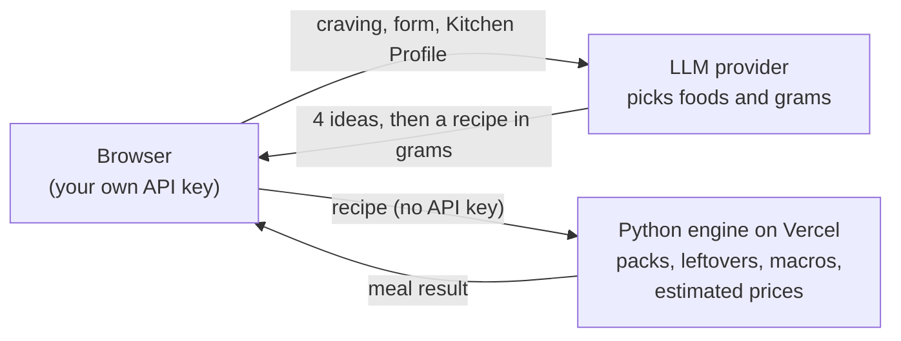

# SmartBite

**Whole-pack meal planner.**

SmartBite turns one craving into one recipe in grams, a shopping list in whole packs, macros per serving and a plan for the leftovers. A language model picks the foods and the grams. Every number after that comes from code: pack sizes, leftovers, macros and estimated prices are plain Python with tests, built on open nutrition and pack data.

Live demo: https://smartbite-steel.vercel.app


## The problem

Most meal planning apps write a plan first and send a list of generic food names to the store. The store then picks the products. Instacart's own API guide, for example, asks apps to send a generic product name with no weight, quantity or brand ([Instacart docs](https://docs.instacart.com/developer_platform_api/guide/how_to/specify_preferred_brands)). Once the product is chosen after the plan, the app cannot know the pack size you pay for or what is left over.

In real life you buy whole packs, and the grams in a recipe decide how many. Take canned tuna in 130 g cans for 7 servings: 93 g per serving is 651 g and buys a 6th can, while 92 g per serving fits in 5 cans. Among the meal apps reviewed for this project in October 2026, none was found that plans around packs like this (for two of them, Eat This Much and Prospre, no source covered it).

SmartBite does it the other way round:

- It plans with typical pack sizes, so the shopping list counts whole packs and the leftover grams are known before you shop.
- It fits leftovers into servings. It can change grams a little or add servings so the packs you buy get used.
- It computes macros in code from open food tables. The model gives only a rough guess on each idea card, and the recipe's macros never come from the model.

## How it works



**The LLM picks foods and grams. All math is code.**

- You bring your own API key. The browser calls the model provider directly, and the key never reaches the SmartBite server.
- The model writes 4 meal ideas, then the full recipe for the one you pick. The recipe prompt tells it to write foods and grams per serving only, and never kcal or protein.
- The engine (`smartbite_engine`, served by FastAPI at `/api/evaluate`) maps each food to open nutrition values and typical pack sizes. It rounds up to whole packs and returns leftovers, macros per serving and, for Spain, an estimated price per pack (national, or for the user's comunidad autónoma).
- When the macros miss their range (kcal within 10% of target, protein 90% to 120% of target) or a fresh food leaves more than 25% of what was bought unused, the browser sends the engine's numbers back to the model for a corrected recipe. That is at most 2 reruns. The rerun prompt gives the model a limit for each bought food of 15% over the first recipe; the reply is not checked against it in code.
- "Adjust leftovers to meals" runs in the browser, also as code with no model. It first tries 1 to 8 servings of the main protein with grams that fill whole packs (cutting more than 15% only while protein stays at or above the target), then moves grams by up to 15% while protein stays at or above 90% of the target, then tries 1 to 8 servings for what is left.

## Results

All numbers below are copied from the result files in `eval/results/`.

### Macros: open tables vs label-based values

The 13 demo meals were computed twice: once by this engine with generic open tables (Ciqual 2025, USDA FoodData Central), and once by the author's personal app, which uses the labels of the products actually bought plus a national food table. The personal values are a reference, not ground truth. Error = (open - reference) / reference, per serving. Built on 2026-10-19 by `eval/macro_compare.py` and re-run on 2026-10-20 after fixes to the pack and nutrition data ([full table](eval/results/macro-compare.md)).

| Meals | kcal mean abs error | kcal max error | kcal within 10% | protein mean abs error | protein max error | protein within 10% |
|---|---|---|---|---|---|---|
| 13 | 5.8% | 22.2% | 12 of 13 | 5.3% | 12.6% | 12 of 13 |

The one meal outside 10% on both is the tuna and chickpea salad with skyr dressing (kcal +22.2%, protein +12.6%).

### Recipe quality eval

15 golden cravings, 11 code checks each (165 checks): valid JSON, 4 ideas, idea names of 60 characters or less, the right number of servings, the recipe keeps the idea's main foods, no excluded food, rice and pasta in dry grams, eggs in units, grams for every ingredient, and macros inside the target range. The checks are code only. Replies for baseline and v2 were written on 2026-10-19. All three runs were re-scored on 2026-10-20 with the same checks, after the nutrition fix ([baseline](eval/results/baseline.md), [v2](eval/results/v2.md), [v3](eval/results/v3.md)).

| Run | Checks passed | macros_vs_target |
|---|---|---|
| baseline | 153/165 (92.7%) | 3/15 |
| v2 | 164/165 (99.4%) | 14/15 |
| v3 | 165/165 (100.0%) | 15/15 |

The baseline first scored 152/165. One baseline recipe added a short top-level "note" that the recipe contract did not allow at the time. The contract now allows an optional note of up to 200 characters, so the same reply passes and all three runs are scored against the same contract.

What changed from baseline to v2 (from the project notes; the baseline prompt was not kept in the repo):

1. The recipe prompt now gives the OK ranges for each macro and tells the model how to hit them: size the main protein for about 75% of the protein target, and fix kcal with the carb and fat foods.
2. The rerun loop: the engine's computed macros and leftovers go back to the model, as in the web app. With the new prompt alone, 6 of 15 first recipes passed the macro check. After reruns, 14 of 15 did. 13 of 15 cases used a rerun (15 reruns in all).

The one remaining miss is a turkey and sweet potato meal at 502 kcal against a 450 kcal target, after 3 attempts.

**Caveat.** The model replies in all three runs came from Claude Code subagents acting as the model, given the same prompts by hand (`eval/run.py prompt`). They were not calls to the production API from the web app. The scoring is the same code either way.

### Cost and model comparison

SmartBite runs on the user's own key, so the cost of a meal is its model calls: one for the 4 ideas, one for the recipe, and one more for each rerun.

**Cost per meal, measured on Gemini.** Live calls to the Gemini API through Google's OpenAI-compatible endpoint, the same route as the web app's experimental adapter, with two models. `gemini-3.8-flash`, the app's Gemini default until 2026-11-01, ran in seven runs from 2026-10-20 to 2026-10-27 (five of them produced meals) and finished 12 of the 15 golden cravings. The other 3 did not finish: the free tier answered with 503 (high demand) and 429 (quota exceeded) errors, or the connection failed. `gemini-3.5-flash-lite`, a cheaper model a user can type in the Model field, finished all 15 in one run on 2026-10-26, with 5 s between calls to stay under the free tier's 15 requests per minute (a first run without the gap hit that limit after 16 calls and is not used). The key was on the free tier, so nothing was billed. The costs below are estimated at Google's paid prices per million input and output tokens: $0.75 and $3.75 for 3.8 Flash (read 2026-10-19), $0.30 and $2.50 for 3.5 Flash-Lite (read 2026-10-26).

| Measure | 3.8 Flash, 12 meals | 3.5 Flash-Lite, 15 meals |
|---|---|---|
| Cost per meal, mean (median) | $0.038 ($0.031) | $0.008 ($0.008) |
| Cost per meal, lowest to highest | $0.021 to $0.071 | $0.004 to $0.010 |
| Model calls per meal, mean | 2.6 (3 of the 31 calls failed and cost nothing) | 3.5 (none failed) |
| Tokens per meal, mean | 5,508 in, 9,013 out | 9,339 in, 1,992 out |
| Time per meal, mean | 452 s (192 s per answered call on the free tier) | 7 s (2 s per call, not counting the 5 s gaps) |

With 3.8 Flash, extra calls drive the cost. The six meals with no rerun cost $0.021 to $0.036. The three whose kept recipe came from a rerun cost $0.041 to $0.071. The turkey and sweet potato meal cost $0.069: its first recipe reply broke the reply format and was asked for again. Per-meal detail: [run 1](eval/results/live-gemini-v3-usage.md) (c02, c03), [run 2](eval/results/live-gemini-v3b-usage.md) (c01, c04, c05, c15), [run 3](eval/results/live-gemini-v3d-usage.md) (c14), [run 4](eval/results/live-gemini-v3e-usage.md) (c07, c10, c12) and [run 5](eval/results/live-gemini-v3f-usage.md) (c09, c11). Flash-Lite costs about a fifth as much per meal although it makes more calls: its replies are short (1,992 output tokens per meal against 9,013), and 14 of its 15 meals needed a rerun. Per-meal detail: [Flash-Lite run](eval/results/live-gemini-lite-2-usage.md). The cost with Claude, the app's default model, has not been measured with a real API run.

**Claude and Gemini on the golden set.**

| Run | Model and route | Cravings | Checks passed | macros_vs_target |
|---|---|---|---|---|
| v3 | Claude, replies written by Claude Code subagents from the same prompts (not the API) | 15 | 165/165 | 15/15 |
| live-gemini | `gemini-3.8-flash`, live API calls | 12 of 15 | 130/132 | 10/12 |
| live-gemini-lite-2 | `gemini-3.5-flash-lite`, live API calls | 15 of 15 | 157/165 | 7/15 |

This is not a like-for-like comparison: the two runs reached the model by different routes, and Gemini covers 12 cravings. Gemini's two misses are both macros: the high-protein Bolognese at 691 kcal against a 600 kcal target, and the turkey and sweet potato meal at 40 g protein against a 45 g target. Both rerun calls failed (a 429 quota error, then a 503 high demand error), so no second recipe was written. The [results file](eval/results/live-gemini.md) scores all 15 cravings and counts the 3 without a reply as failed (130/165).

Flash-Lite passes every format and food check but misses the macro targets on 8 of 15 meals. Its first recipe hit the targets in 2 of 15 meals, and its reruns often overshoot the other way: the chicken pasta went from 737 kcal to on target, then back to 654 kcal against a 500 kcal target. The scorer checks the last recipe. For that chicken pasta the app would show the second recipe, the one with the fewest problems, so by what the app shows Flash-Lite hits the macros in 8 of 15. [Results file](eval/results/live-gemini-lite-2.md).

## Data and licenses

| Part | Source | License | Where |
|---|---|---|---|
| Code | This repo | AGPL-3.0 | `LICENSE` |
| Nutrition (first choice) | Ciqual 2025, ANSES | Licence Ouverte / Open Licence 2.0 (Etalab 2.0). Cite: Anses. 2025. Table de composition nutritionnelle des aliments Ciqual. https://doi.org/10.57745/RDMHWY | `data/open/nutrition/` |
| Nutrition (where Ciqual has no good match) and loose produce weights | USDA FoodData Central | CC0 1.0 (public domain) | `data/open/nutrition/`, `data/open/packs/` |
| Typical pack sizes | Open Food Facts, products sold in Spain (export of 2026-10-18) | ODbL 1.0, with its own `LICENSE` in the folder | `data/open/packs/` |
| Estimated prices, Spain | MAPA, Panel de consumo alimentario en hogares, Aug 2025 to Jul 2026 | Reuse under Ley 37/2007 with attribution (not a named open licence) | `data/open/prices/` |

The nutrition table has 138 foods (125 from Ciqual, 13 from USDA). Pack sizes cover 139 foods (102 from Open Food Facts, 20 from USDA portion weights, 17 set by hand with a reason in data/build/packs-overrides.json). Estimated prices exist for 76 of them, the ones with an exact or close match in the MAPA panel. Each of the 17 comunidades autónomas has its own price for 63 to 76 of those foods (only foods with data in every month the national price has); the rest use the national price. Each folder has a `SOURCES.md` with download dates, fields used and how the files were built.

BEDCA, the Spanish food composition database, is not used: its terms do not allow non-personal electronic use without written permission from AESAN.

## Run locally

Python 3.11 or newer and Node.js. From the repo root:

```bash
python3 -m venv .venv
.venv/bin/pip install -r requirements.txt -r requirements-dev.txt
.venv/bin/python -m pytest -q

# engine on port 8100
.venv/bin/uvicorn api.index:app --host 127.0.0.1 --port 8100
curl http://127.0.0.1:8100/api/health
```

In a second terminal:

```bash
cd web
npm install
npm run dev     # web app on http://127.0.0.1:3100, sends /api/evaluate to the engine on 8100
npm test        # unit tests
npm run e2e     # Playwright flow test; needs the engine and the dev server running, the model is mocked
```

## Deploy

One Vercel project with two services: the FastAPI engine and the Next.js web app, routed by `vercel.json`. Keep the Root Directory at the repo root. Details, sources and what is still untested are in [docs/deploy.md](docs/deploy.md).

## Privacy and AI

- **Your key stays in your browser.** It is kept in this browser's localStorage and sent only to the provider you chose. The engine request has no key in it.
- **No accounts.** Your Kitchen Profile, cart and saved meals live in your browser.
- **The engine keeps nothing.** `api/index.py` reads the request, computes the meal and returns it. The engine has no database, writes no files and makes no outside calls while it evaluates a meal. When the engine fails, it logs one line to stderr with an error id, the error type, code locations and the request's size and counts, never the request body, its values, headers or a key. Vercel, as the host, has its own request logs, which this code does not control.
- **What goes where.** Your craving, form and Kitchen Profile go from your browser to the model provider, under that provider's terms. The form, profile, picked idea and recipe go to the engine.
- **AI labels.** Ideas, recipes and the demo photos are labeled AI-generated in the app.
- **Providers.** Anthropic is the tested provider (Claude Sonnet 5.5 by default, Claude Haiku 5.5 as an option). An OpenAI-compatible adapter (OpenAI, OpenRouter, Gemini, Ollama on your own computer) is marked experimental: Gemini has been run through it (3.8 Flash on 12 of the 15 golden cravings, 3.5 Flash-Lite on all 15, above, and 3.6 Flash, the Gemini default since 2026-11-01, on 4 of them before the free tier's daily limit stopped the run: ideas 5.5 s and recipe 17.7 s per call (median), macros on target in all 4); other models have not been tested.

## Limitations

- Estimated prices are national or regional averages over all brands, shops and promotions, not prices from any one store. Regional samples are smaller, so a regional price can be further off for a single food.
- Canned and jarred foods may get low price estimates. SmartBite pack sizes use drained weight, while the MAPA panel probably counts net weight.
- Nutrition comes from generic food tables, not from the label of the product you buy.
- The UI is in English only for now.
- The demo meals are the author's own meals, recomputed by this engine with all store data removed.
- The eval set is small (15 cravings) and was run with Claude Code subagents, not the production API.

## Tech stack

Python (standard library engine, FastAPI API, pytest), Next.js 16, React 19, Tailwind CSS 3, Playwright, Vercel Services.

## License

Code: [AGPL-3.0](LICENSE). Data files keep their own licenses and attribution, listed in [Data and licenses](#data-and-licenses).

## Author

Built by [Marian Garabana](https://www.linkedin.com/in/marian-garabana-garrido/).
